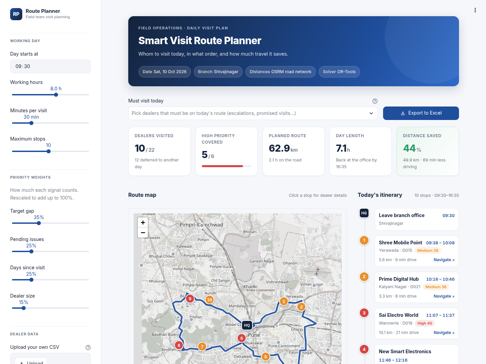

# Smart Visit Route Planner for Field Teams

**It tells a field manager whom to visit today, in what order, and how much travel time it saves.**



A field manager at an NBFC handles 15–25 dealers (electronics, mobile, appliance and two-wheeler stores
where consumer loans are sold) and usually decides each morning from memory whom to visit. This app
ranks dealers by business priority, picks the most important ones that fit into the working day,
finds the shortest road route between them, and exports a timed plan to Excel.

## Features

- **Business-driven priority score** (0–100) from target gap, pending issues, days since last visit and dealer size, with adjustable weights
- **Real road distances** from OpenStreetMap via OSRM (no API key), with an offline fallback
- **Route optimisation** with Google OR-Tools: prize-collecting TSP with working-hours and max-stops limits
- **Must-visit dealers** that are never dropped
- **Interactive map**: numbered stops coloured by priority, skipped dealers in grey, road-following route
- **Timed schedule** with arrival/leaving times and a Google Maps navigation link per stop
- **Planned vs. unplanned comparison**: km and drive time saved
- **Excel export**: Visit Plan, Not Visited Today, Summary
- **Upload your own CSV**

## Quick start

```bash
python -m venv .venv && source .venv/bin/activate
pip install -r requirements.txt
python data/generate_dealers.py      # sample data (already committed as data/dealers.csv)
streamlit run app.py                 # opens http://localhost:8501
```

Without the UI:

```bash
python run_cli.py --hours 8 --visit-min 30 --max-stops 10 --must-visit D010
python run_cli.py --offline          # estimated distances, no internet needed
```

Run the tests: `pip install -r requirements-dev.txt && pytest -q`

## How it works

```
Dealer CSV ──▶ 1. Priority scoring ──▶ 2. Distance matrix ──▶ 3. Route optimiser ──▶ 4. Map, schedule, KPIs, Excel
               (which dealers matter)   (road km & minutes)    (which dealers + order)
```

### 1. Priority scoring — `planner/priority.py`

```
Score = 100 × (0.35 × Target gap + 0.25 × Pending issues + 0.25 × Days since visit + 0.15 × Dealer size)
```

| Factor | Weight | Measure |
|---|---|---|
| Target gap | 35% | (Target − Achieved) ÷ Target; 0 if already above target |
| Pending issues | 25% | Open issues ÷ 5 (capped at 5) |
| Days since visit | 25% | Days ÷ 30 (capped at 30) |
| Dealer size | 15% | Dealer's target ÷ largest dealer's target |

Tiers: **High** ≥ 40, **Medium** 30–40, **Low** < 30. Weights can be changed with sliders (rescaled to sum to 100%).

### 2. Distance matrix — `planner/distance.py`

Road distance and drive time between every pair of locations (branch office + all dealers) from the
OSRM `table` API. OSRM returns free-flow times, so they are multiplied by a traffic factor
(default 1.5, adjustable). Offline fallback: straight-line (haversine) distance × 1.35 at 20 km/h.

### 3. Route optimisation — `planner/optimizer.py`

A prize-collecting Travelling Salesman Problem solved with the OR-Tools routing library:

- start and end at the branch office (Shivajinagar)
- **cost** = road distance
- **Time dimension**: drive time + a fixed visit time per dealer must fit the working day
- **Stops dimension**: at most *N* visits
- every dealer is optional with a **skip penalty equal to its priority score**, so low-priority dealers are dropped first
- **must-visit** dealers have no skip option
- search: Path Cheapest Arc first solution, improved with Guided Local Search

**Backup** (if OR-Tools isn't installed): insert must-visit dealers first, then repeatedly add the
dealer with the best priority per extra minute of the day (detour + visit), then improve the order with
**2-opt** (reverse segments to remove crossings).

### 4. Output — `planner/report.py`

Timed schedule, Folium map, KPIs and a three-sheet Excel workbook. The **unplanned baseline** visits the
same dealers in "most urgent first" order without route planning.

## Sample run

22 fictional dealers in Pune · 8-hour day · 30 min per visit · max 10 stops

| Distances | Dealers visited | High priority | Planned | Unplanned | Saved | Day length |
|---|---|---|---|---|---|---|
| OSRM roads (traffic × 1.5) | 10 / 22 | 5 / 6 | 62.9 km | 112.8 km | **44%** | 7.1 h |
| Offline estimate | 10 / 22 | 5 / 6 | 52.4 km | 82.0 km | **36%** | 7.6 h |

## Input CSV

| Column | Meaning |
|---|---|
| `dealer_id`, `dealer_name`, `area` | Who the dealer is and where |
| `latitude`, `longitude` | GPS location |
| `monthly_target_lakh` | Monthly loan disbursal target (₹ lakh) |
| `achieved_lakh` | Achieved so far this month |
| `pending_issues` | Open complaints, document or payout issues |
| `days_since_last_visit` | Days since the last visit |
| `must_visit` *(optional)* | 1 to pre-select as must-visit |

## Project structure

```
smart-visit-route-planner/
├── app.py                    Streamlit web app
├── ui.py                     Styled UI components (header, KPI cards, itinerary)
├── run_cli.py                Run the planner without the UI
├── requirements.txt
├── data/
│   ├── generate_dealers.py   Creates the sample dealer dataset
│   └── dealers.csv
├── planner/
│   ├── priority.py           Priority scoring
│   ├── distance.py           Distance and time matrix (OSRM / estimate)
│   ├── optimizer.py          Route optimisation (OR-Tools + backup)
│   └── report.py             Schedule, map and Excel export
└── tests/                    pytest suite (planner + headless app test)
```

## Limitations and future scope

| Limitations | Future scope |
|---|---|
| No live traffic (typical drive times × traffic factor) | Weekly multi-day planning |
| Same visit duration for every dealer | Dealer opening-time windows |
| Dealer opening hours not considered | Multiple reps sharing one territory |
| One day, one person | Live traffic (Google Maps API), mobile app with GPS check-in |

---
Sarthak Bendre · B.Tech CSE, MIT World Peace University, Pune
